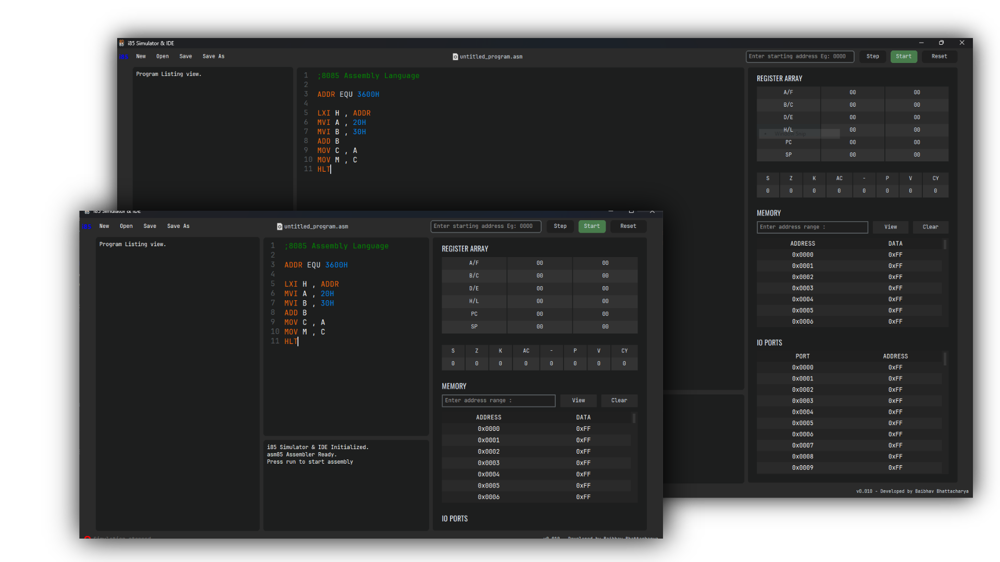

> [!WARNING]
> **i85 Simulator & IDE is in development** and no stable release has been published.

# i85 Simulator & IDE
> **i85 Simulator** is a desktop application for running and debugging 8085 Assembly Language programs.  

It is a functional simulator with support for all the 246 Documented Instructions and All the 7 flags (The usual 5 flags and the undocumented 
Overflow and X5 Flags) for simulation accuracy. It keeps track of the total T-States in a program and calculates the total time which will be taken 
by a real 8085 Microprocessor, however it does not simulate hardware accurate timing and runs at a much slower speed for viewing and debugging convenience.  

# i85 IDE 

# Features

- Syntax Highlighting 
- Program Listing View
- Register View
- Memory & IO Port View
- Instruction Stepping
- Support for Infinite Loops
- Hardware Cycle Counting

# Installation Instructions

1. Download the <kbd>i85-simulator-setup-x64.exe</kbd> from the releases page.
2. Install the application using the setup file.
3. You can use the application from the desktop shortcut.

# Minimum System Requirements

- Windows 10 / 11
- 64 Bit Dual Core Intel/AMD processor with minimum 1.8GHz Clock Speed
- 4GB System Memory (8GB Recommended)
- 2GB Hard Disk Space

# Licensing & Credits

i85 Simulator & IDE is licensed under the [MIT-LICENSE](LICENSE) It has been completely designed and developed by
**Baibhav Bhattacharya**  

i85 Simulator uses asm85 as its assembler.   
[asm85 &mdash; TomNisbet](https://github.com/TomNisbet/asm85)  

It also contains the following customTkinter addons with/without modifications:  

[CTkCodeBox &mdash; Akascape](https://github.com/Akascape/CTkCodeBox)  
[CTkTable &mdash; Akascape](https://github.com/Akascape/CTkTable)

# Documentation & Changelog

[User Guide](Documentation/Usage%20Instructions.md)  
[Dependencies](Documentation/Dependencies.md)  
[sim85 Documentation](Documentation/Simulator%20Documentation.md)  
[Changelog](Changelog/Changelog.md)

# Inspiration
i85 Simulator has been inspired by [GnuSim8085](https://github.com/gnusim8085/gnusim8085) and
aims to be an alternative which fixes some technical and design aspects.

---
